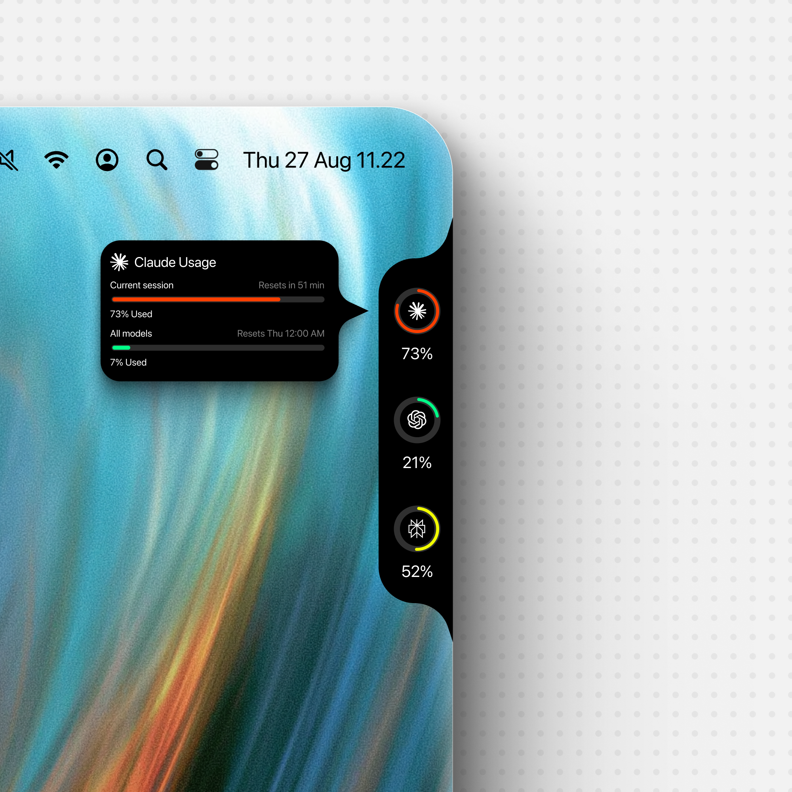
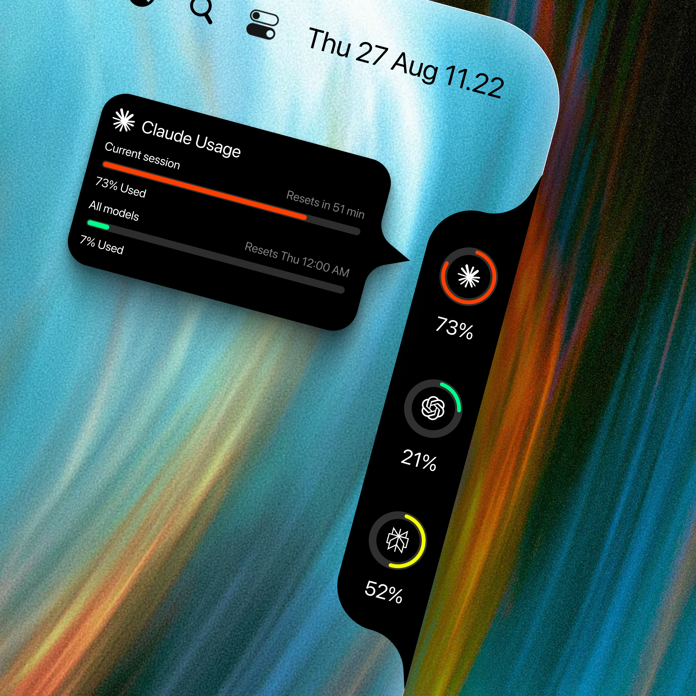

<p align="center">
  
</p>

# Codexnotch for Linux


**Um aplicativo nativo exclusivo para Linux (X11 / XWayland) que fixa um _notch_ discreto na borda da tela, exibindo em tempo real o consumo de cotas dos seus assistentes de código com IA, a atividade das sessões locais (_working_, _waiting_, _done_) e modelos locais carregados no Ollama e LM Studio.**

<p align="center">
  
  &nbsp;
  
</p>

---

## Tutorial Rápido de Uso

### 1. Instalar e abrir

Se você compilou do código-fonte (veja a seção [Compilação](#-compilação-ubuntu--debian) abaixo):

```bash
./scripts/install-linux.sh
codenotch
```

O Codenotch aparece imediatamente:

- Como uma **pílula (notch)** presa na borda da tela;
- Como um **ícone na bandeja do sistema** (perto do relógio).

> **Dica:** Na primeira vez, o notch fica no modo _Exibir ao passar o cursor_ (ou sempre visível). Encoste o mouse na pílula na borda para abrir os anéis.

---

### 2. Como interagir com o Notch (Atalhos)

| Ação                                                                                          | O que faz                                                                                                                                 |
| :-------------------------------------------------------------------------------------------- | :---------------------------------------------------------------------------------------------------------------------------------------- |
| **Passar o mouse em um anel**                                                                 | Abre o **pop-up de detalhes** com a porcentagem exata de cada limite, barra de progresso, tempo restante até a renovação e sessões ativas |
| **Clicar em um anel**                                                                         | Força a **atualização imediata** da leitura daquele provedor                                                                              |
| **Clicar no arco/engrenagem ao lado da pílula**                                               | Abre a janela **Configurações (Codenotch Settings)**                                                                                      |
| **Segurar `Alt` + arrastar a pílula** _(ou arrastar pelos 6 pontinhos ao lado da engrenagem)_ | Move o notch livremente para qualquer ponto das **4 bordas** (`esquerda`, `direita`, `superior`, `inferior`) ou outro monitor             |
| **Botão direito na pílula ou ícone da bandeja**                                               | Menu rápido para alternar _Manter aberto_, atualizar tudo, abrir Configurações ou encerrar                                                |

---

### 3. Como ler as cores e anéis

- **Anel colorido (uso):**
  - **Verde** — uso confortável (abaixo do limite de atenção, padrão `< 50%`);
  - **Amarelo** — atenção (padrão `50% – 69%`);
  - **Vermelho** — crítico (padrão `>= 70%`).
  - Você pode escolher entre mudança em **Degrau seco** ou **Rampa de cor contínua** e ajustar os limites em **Configurações → Aparência → Limites de uso**.
- **Anel interno branco girando:** o assistente está trabalhando em uma tarefa agora.
- **Anel interno amarelo pulsando:** o assistente está aguardando sua resposta ou aprovação.
- **Ícone/anel esmaecido:** a última leitura está desatualizada (> 15 min) ou o provedor está offline; clique no anel para tentar ler novamente.

---

### 4. Como configurar seus provedores de IA

Abra **Configurações → Contas** (use a barra de busca para filtrar qualquer um dos 14 provedores e clique em **Atualizar agora** para testar na hora):

- **Claude Code:** basta estar logado no `claude`. Você também pode ativar **"Permitir que o Claude Code notifique o Codenotch"** para instalar os hooks automaticamente (faz o anel girar/pulsar em tempo real) e adicionar **múltiplas contas Claude** em paralelo.
- **Google Antigravity:** detectado automaticamente pelo CLI (`agy`) ou sessão local aberta. Escolha na própria linha se o anel principal lê **Automático**, **Limite de 5 horas** ou **Limite semanal**, e qual família de modelos acompanhar (**Modelos Gemini** ou **Modelos Claude e GPT**).
- **Cursor / OpenAI Codex / OpenCode / Command Code / Qoder / Grok / GitHub Copilot / GLM / DeepSeek / Mistral:** detectados automaticamente a partir das sessões/credenciais locais já autenticadas na máquina.
- **Ollama (LLM local):** basta rodar `ollama serve` na porta padrão `11434` (`http://127.0.0.1:11434`). O Codenotch mostra os modelos carregados em VRAM/RAM.
- **LM Studio (LLM local):** ative o _Local Server_ na porta padrão `1234` (`http://127.0.0.1:1234`) para ver os modelos ativos no notch.

> **Atenção:** Ative a chave ao lado de cada provedor que você quer fixar no notch. Pelo menos um provedor permanece ativo para que a pílula nunca fique vazia.

---

### 5. Modo Leve (PCs fracos e notebook na bateria)

O Codenotch foi otimizado para rodar liso tanto em máquinas fracas quanto em PCs potentes:

- Sem filtros SVG `feGaussianBlur` pesados no compositor do Linux;
- Atualização diferencial do DOM e região de clique Cairo (só redesenha quando algo realmente muda);
- Animações pausadas automaticamente quando o notch está recolhido.

Para deixar **ainda mais leve em PCs fracos**:

1. Abra **Configurações → Aparência**.
2. Ative **Modo leve (PCs fracos)**.
3. Isso desliga animações contínuas dos anéis e transições, mantendo atualizações instantâneas com uso mínimo de CPU/GPU.

---

## Principais Recursos

- **Notch flutuante nativo para Linux (X11 / XWayland):**
  - Pílula vetorial limpa com cantos côncavos (_fillets_), pop-up detalhado com porcentagens em destaque e arraste suave entre qualquer borda (`left`, `right`, `top`, `bottom`).
  - **Click-through cirúrgico via Cairo (`gdk_window.input_shape_combine_region`):** cliques fora da pílula ou do pop-up atravessam direto para a janela de trás, sem polling global de ponteiro.
  - **Detecção real de tela cheia via EWMH (`_NET_WM_STATE_FULLSCREEN`):** recolhe automaticamente o notch durante vídeos, apresentações ou jogos.
  - **Foco direto no terminal da sessão (`/proc` + `_NET_ACTIVE_WINDOW`):** clique na sessão ativa para focar o terminal correspondente; ao voltar ao terminal, o estado _done_ limpa sozinho.
- **14 Provedores suportados no Linux:**
  1. **Claude Code** — Multi-conta (`~/.claude` e `~/.claude-<slug>`), hooks determinísticos via `codenotch-hook` e _Transcript Watcher_.
  2. **OpenAI Codex** — `~/.codex/auth.json`, `codex` app-server e SQLite WAL.
  3. **Cursor** — Leitura read-only WAL de `~/.config/Cursor/User/globalStorage/state.vscdb`.
  4. **Google Antigravity** — CLI `agy` (interativo e TSV), bridge local do `language_server` e contagem de passos em `transcript.jsonl`.
  5. **GitHub Copilot** — `GH_TOKEN`/`GITHUB_TOKEN`, `~/.config/gh/hosts.yml` ou `gh auth token`.
  6. **Grok** — `~/.grok/auth.json`.
  7. **OpenCode / OpenCode Go** — `~/.local/share/opencode/auth.json` e `opencode.db`.
  8. **GLM (Z.ai / ZCode)** — Chave em Claude/OpenCode ou cofre ZCode (AES-256-GCM).
  9. **DeepSeek Harness** — Transcripts `.jsonl.zstd` em `~/.dsh` + saldo da API.
  10. **Command Code** — `~/.commandcode/auth.json`.
  11. **Qoder** — Sidecar `@qoder-ai/qoder-agent-sdk` (`qodercli`).
  12. **Mistral AI / Vibe** — `MISTRAL_API_KEY`, `mistral.json` ou `~/.vibe/.env`.
  13. **Ollama (Local)** — `http://127.0.0.1:11434/api/ps`.
  14. **LM Studio (Local)** — `http://127.0.0.1:1234/api/v1/models`.
- **Alertas de renovação de cota & Autostart XDG:**
  - Card flutuante + notificação nativa (`notify-send`).
  - Inicialização automática por usuário em `~/.config/autostart/codenotch.desktop`.

---

## Estrutura do Repositório (100% Linux-Only)

```text
codenotch-linux/
├── Cargo.toml                  # Workspace Rust (codenotch + codenotch-hook)
├── docs/design/                # Imagens de referência e banner do projeto
├── crates/
│   ├── codenotch/              # Aplicativo principal Tauri 2 + GTK3 + X11
│   │   ├── Cargo.toml
│   │   ├── tauri.conf.json
│   │   ├── qoder-usage.cjs
│   │   ├── glyphs/             # Ícones SVG monocromáticos embarcados
│   │   ├── icons/              # Ícones da aplicação
│   │   ├── ui/                 # Frontend (notch.html, settings.html, carry.html, reset-alert.html)
│   │   └── src/                # Módulos Rust (providers, X11 focus, Cairo input shape, SQLite WAL, servidor local :48666)
│   └── codenotch-hook/         # Cliente CLI zero-dependency para hooks do Claude Code
├── scripts/
│   ├── run-linux.sh            # Launcher X11/XWayland com limpeza de ambiente snap
│   ├── install-linux.sh        # Instalador user-space (~/.local/bin + ~/.local/share/applications)
│   ├── check-ui-scripts.mjs    # Verificador estático de sintaxe JS/HTML da UI
│   └── tests/                  # Suíte de testes unitários da UI (node --test)
└── .github/workflows/
    └── ci-linux.yml            # Pipeline CI/CD Ubuntu 24.04 (.deb, .AppImage, .tar.gz)
```

---

## Compilação (Ubuntu / Debian)

### 1. Instalar dependências de sistema do GTK3 / WebKit2GTK (Tauri 2)

```bash
sudo apt update
sudo apt install -y \
  pkg-config \
  build-essential \
  libssl-dev \
  libgtk-3-dev \
  libwebkit2gtk-4.1-dev \
  libayatana-appindicator3-dev \
  librsvg2-dev \
  patchelf
```

### 2. Rodar testes e compilar os binários

```bash
# Validar sintaxe e testes unitários da UI (Node.js)
node scripts/check-ui-scripts.mjs
for f in scripts/tests/test-*.cjs; do node --test "$f"; done

# Rodar suíte de testes Rust
cargo test --workspace

# Compilar binários otimizados de release
cargo build --release --workspace
```

### 3. Instalar no seu usuário (`~/.local/bin/codenotch` + menu de aplicativos)

```bash
./scripts/install-linux.sh
codenotch
```

Ou executar diretamente do repositório:

```bash
./scripts/run-linux.sh
```

---

## Solução de Problemas

- **O notch não aparece ou fica atrás de janelas no Wayland:** use sempre o comando `codenotch` ou `./scripts/run-linux.sh`, que força `GDK_BACKEND=x11` (via XWayland) para que a ancoragem e o _click-through_ funcionem corretamente.
- **Erro `failed to bind port 48666`:** já existe outra instância do Codenotch rodando (por exemplo, um pacote `.deb` antigo). Encerre pela bandeja do sistema ou remova versões antigas com `sudo apt remove codenotch`.
- **Logs e diagnóstico:** rode `codenotch doctor` no terminal ou abra a pasta de dados em **Configurações → Geral → Pasta de dados** (`~/.config/codenotch/run.log`).

---

## Licença

Distribuído sob a licença [MIT](LICENSE).
